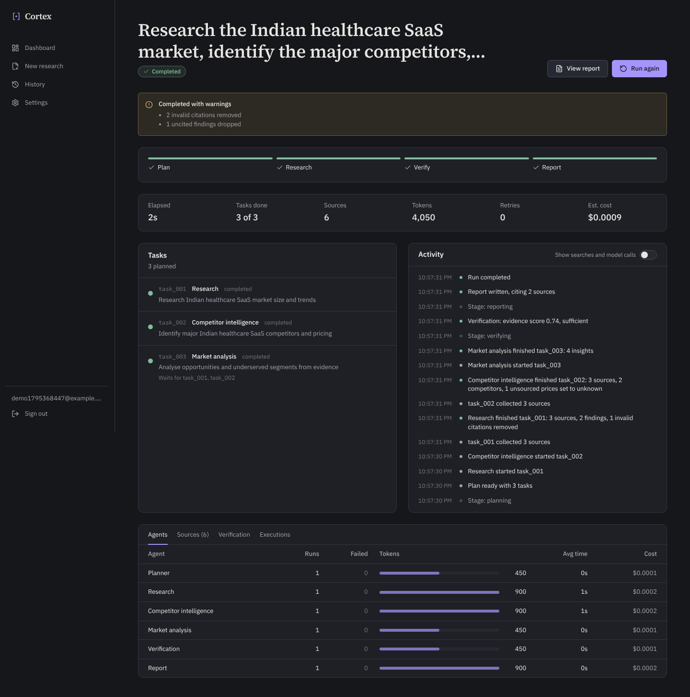
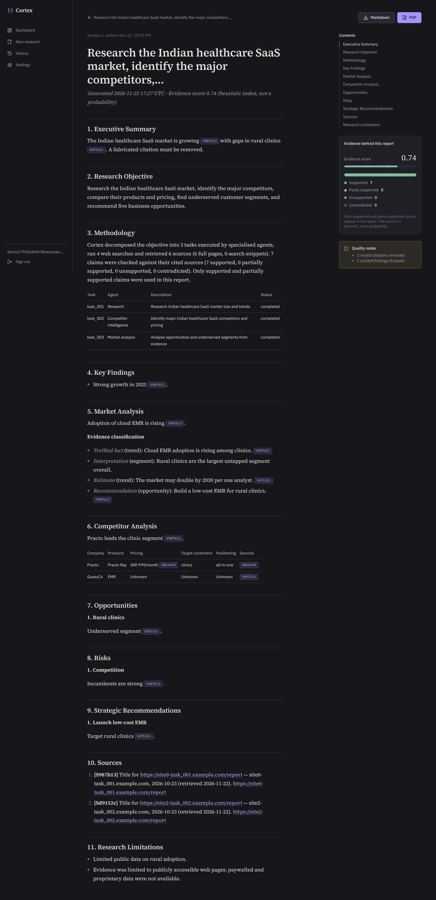

# Cortex

Autonomous multi-agent research and decision-intelligence platform. Cortex takes a research
objective, plans it into tasks, runs specialised agents (research, competitor intelligence,
market analysis) against real web sources, verifies claims against the evidence it actually
retrieved, and produces a cited report.

**Status: all 7 phases built; deployment-ready for Vercel + Render + Supabase.** Not yet deployed or run against live Groq/Tavily keys. See [docs/architecture.md](docs/architecture.md).

| Live run | Cited report |
|---|---|
|  |  |

More: [landing](docs/screenshots/landing.png) · [dashboard](docs/screenshots/dashboard.png) · [plan approval](docs/screenshots/plan-approval.png).
Screenshots come from a local run with scripted agents (`scripts/dev_fake_backend.py`), so the report content is placeholder text.

## Stack

FastAPI · Pydantic · SQLAlchemy 2.1 (async, psycopg 3) · Alembic · LangGraph · Groq
(primary) / Gemini (optional) · Tavily or Exa · PostgreSQL · Redis · Next.js · LangSmith

## Local development

Requirements: Python 3.12+, Node 22+, PostgreSQL 16, Redis 7 (or Docker).

```bash
cp .env.example backend/.env          # fill in keys you have
cd backend
uv venv -p 3.12 .venv && uv pip install -p .venv -r requirements-dev.txt
.venv/bin/python ../scripts/check_env.py   # verifies Postgres, Redis, lists integrations
.venv/bin/alembic upgrade head
.venv/bin/uvicorn app.main:app --reload   # http://localhost:8000/docs
```

Frontend (in another terminal):

```bash
cd frontend && cp .env.example .env.local && npm install && npm run dev   # http://localhost:3000
```

No API keys yet? `cd backend && .venv/bin/python ../scripts/dev_fake_backend.py` runs the real API
with scripted agents (dev only; refuses to start in production).

Or run the whole stack: `cp .env.example .env && docker compose up --build`.

## Tests

```bash
cd backend
.venv/bin/pytest                 # unit tests, mocked LLM/search, no network
.venv/bin/pytest -m integration  # needs Postgres + Redis
```

Coverage is 95% (CI enforces 85%). Tests marked `live` call paid APIs and never run in CI.

Evaluation (16 benchmarks, 8 metrics, human review): see [docs/evaluation.md](docs/evaluation.md).
Security model: [docs/security.md](docs/security.md). Once `GROQ_API_KEY` and a search
key are set, `.venv/bin/python ../scripts/live_smoke.py` runs one real quick workflow and
writes `smoke_report.md`.

## Deployment

Free-tier production setup (Supabase Postgres, Render for the API and Key Value via
`render.yaml`, Vercel for the frontend, LangSmith for tracing), step by step:
[docs/deployment.md](docs/deployment.md). After deploying,
`scripts/smoke_deployed.py <frontend-url>` verifies the live stack through the browser path.

## Repository layout

```
backend/app/   api · agents · graph · tools · services · models · schemas
               repositories · core · evaluation · monitoring · database
backend/tests/ unit · integration
frontend/      Next.js app: app/ (routes, BFF route handlers) · components/ · hooks/ · services/ · types/
docs/          architecture · api · agent-design · evaluation · security · deployment
render.yaml    Render blueprint (API + Key Value)
scripts/       operational helpers
```
